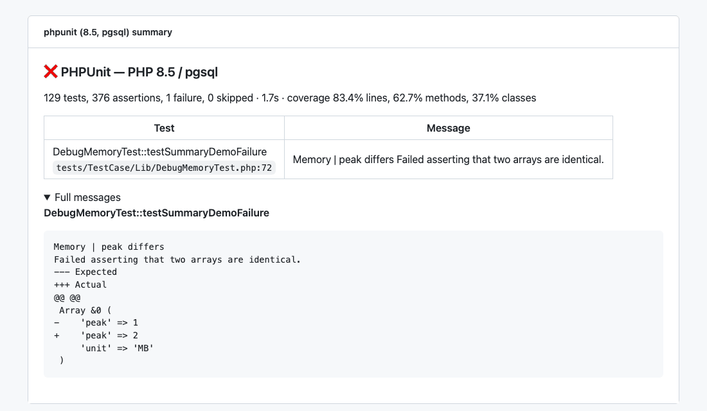
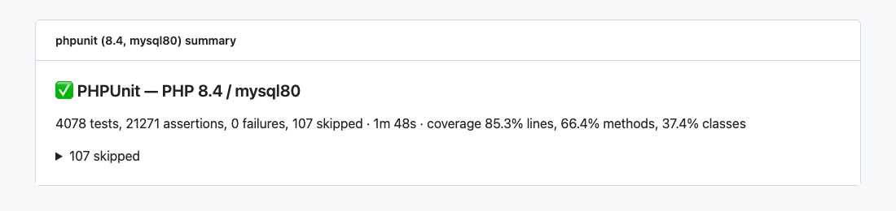
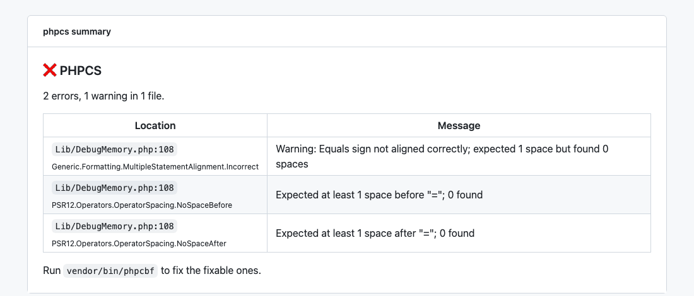
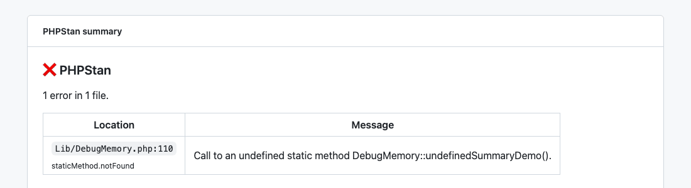
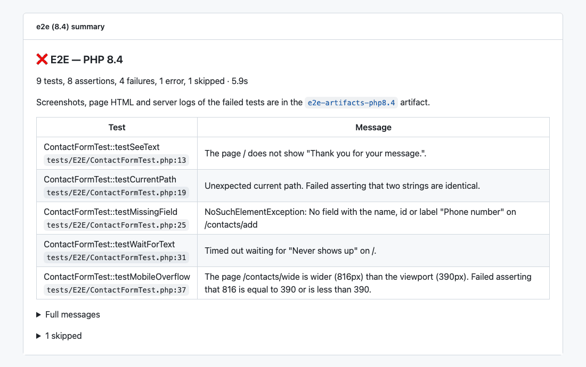

# ci-summary

A GitHub Actions composite action that turns a test or code analysis report into a short
[job summary](https://docs.github.com/en/actions/reference/workflows-and-actions/workflow-commands#adding-a-job-summary),
so that the result of a job can be read on the run page without opening the log.

It reads:

- **JUnit XML** from PHPUnit (`--log-junit`), optionally with a Clover coverage report, and from any other
  tool that writes JUnit XML, such as pytest and Jest
- **Checkstyle XML** from PHP_CodeSniffer (`--report-checkstyle`)
- **PHPStan** results (`--error-format=json` or `--error-format=checkstyle`)

It works in any repository. It has no dependencies besides PHP on the runner, needs no token and no
permissions, and never fails the job.



## Contents

- [What it shows](#what-it-shows)
- [Requirements](#requirements)
- [Usage](#usage)
  - [PHPUnit with coverage in a matrix](#phpunit-with-coverage-in-a-matrix)
  - [PHP_CodeSniffer with cs2pr](#php_codesniffer-with-cs2pr)
  - [PHPStan](#phpstan)
  - [End-to-End tests with failure artifacts](#e2e-tests-with-failure-artifacts)
  - [pytest, Jest and other JUnit XML](#pytest-jest-and-other-junit-xml)
- [Inputs](#inputs)
- [Missing or broken reports](#missing-or-broken-reports)
- [Permissions](#permissions)
- [Versions](#versions)
- [Development](#development)
- [Origin](#origin)
- [License](#license)

## What it shows

Every summary starts with a heading with ✅, ⚠️ or ❌ and the title you give, then one line with the counts.

**Tests (JUnit XML).** Tests, assertions (PHPUnit only), failures, errors, warnings and skipped tests, the
time, and the line, method and class coverage when a Clover report is given:



When tests fail, a table lists each failed test with the file and line in the test where it failed, and the
message. Long messages, such as assertion diffs or the text of a whole page, are shortened in the table and
shown in full in a collapsed *Full messages* section (up to 10). Skipped tests are listed in another
collapsed section with their reasons.

**Coding standard (checkstyle).** The number of errors and warnings and a table with the location, the rule
and the message of each one:



**PHPStan.** The number of errors and a table with the location, the identifier and the message. General
errors without a file, such as an ignored error pattern that was not matched, are listed too:



Tables show at most 50 rows; the rest are counted and left to the job log. Paths are relative to the
repository root. All text from the reports is escaped, so a message cannot break the table or add markup.

The summary is also printed in a collapsed group of the step's log. The action only formats reports:
annotations on the pull request diff, for example from
[cs2pr](https://github.com/staabm/annotate-pull-request-from-checkstyle), stay in their own step.

## Requirements

- **PHP 8.0 or later on the runner**, with the SimpleXML and JSON extensions (both are on by default).
  GitHub-hosted Ubuntu runners come with PHP. In a PHP project, the job usually sets PHP up anyway with
  [`shivammathur/setup-php`](https://github.com/shivammathur/setup-php); in other projects, add that step
  before this action if your runner has no PHP. Without PHP, the step writes a warning and no summary.
- **`bash`**, which every GitHub-hosted runner has.

The action never fails the job: a missing PHP, a missing or broken report, or an error in the script ends in a
warning, and the step still succeeds. Your test or analysis step decides whether the job passes.

## Usage

Run the action after the step that writes the report, with `if: ${{ !cancelled() }}`, so that it also runs
when that step fails:

```yaml
- name: Run tests
  run: vendor/bin/phpunit --log-junit junit.xml

- name: Test summary
  if: ${{ !cancelled() }}
  uses: pieceofcake2/ci-summary@v1
  with:
    type: junit
    file: junit.xml
```

### PHPUnit with coverage in a matrix

Put the matrix values into the title, so that the summaries of the jobs can be told apart on the run page:

```yaml
jobs:
  phpunit:
    runs-on: ubuntu-latest

    strategy:
      fail-fast: false
      matrix:
        php-version: ['8.1', '8.4']
        db-type: [mysql, pgsql]

    steps:
      - uses: actions/checkout@v7

      - uses: shivammathur/setup-php@v2
        with:
          php-version: ${{ matrix.php-version }}
          coverage: pcov

      - run: composer install --no-interaction --no-progress

      - name: Run tests
        run: vendor/bin/phpunit --log-junit junit.xml --coverage-clover coverage.xml

      - name: Test summary
        if: ${{ !cancelled() }}
        uses: pieceofcake2/ci-summary@v1
        with:
          type: junit
          title: PHPUnit — PHP ${{ matrix.php-version }} / ${{ matrix.db-type }}
          file: junit.xml
          coverage: coverage.xml
```

PHPUnit 9 and later write the JUnit and Clover reports this action reads.

### PHP_CodeSniffer with cs2pr

`--report-full` keeps the readable report in the log, `--report-checkstyle` writes the file for cs2pr and
for the summary:

```yaml
- uses: shivammathur/setup-php@v2
  with:
    php-version: '8.4'
    coverage: none
    tools: cs2pr

- run: composer install --no-interaction --no-progress

- name: Check code style
  id: phpcs
  run: vendor/bin/phpcs --report-full --report-checkstyle=phpcs-report.xml

- name: Annotate the pull request
  if: ${{ always() && steps.phpcs.outcome == 'failure' }}
  run: cs2pr phpcs-report.xml

- name: PHPCS summary
  if: ${{ !cancelled() }}
  uses: pieceofcake2/ci-summary@v1
  with:
    type: checkstyle
    title: PHPCS
    file: phpcs-report.xml
```

For a phpcs report, the summary ends with a hint to run `vendor/bin/phpcbf`.

### PHPStan

With checkstyle output, the same file can also go to cs2pr:

```yaml
- name: Run PHPStan
  id: phpstan
  run: vendor/bin/phpstan analyse --no-progress --error-format=checkstyle > phpstan-report.xml

- name: Annotate the pull request
  if: ${{ always() && steps.phpstan.outcome == 'failure' }}
  run: cs2pr phpstan-report.xml

- name: PHPStan summary
  if: ${{ !cancelled() }}
  uses: pieceofcake2/ci-summary@v1
  with:
    type: phpstan
    title: PHPStan
    file: phpstan-report.xml
```

Or with JSON output:

```yaml
- name: Run PHPStan
  run: vendor/bin/phpstan analyse --no-progress --error-format=json > phpstan.json

- name: PHPStan summary
  if: ${{ !cancelled() }}
  uses: pieceofcake2/ci-summary@v1
  with:
    type: phpstan
    file: phpstan.json
```

<a id="e2e-tests-with-failure-artifacts"></a>

### End-to-End tests with failure artifacts

Browser end-to-end (E2E) tests often save screenshots, the page HTML and server logs when a test fails, and
the job uploads them as an artifact. Set `artifact-name` to the name of that artifact: when tests failed, the
summary adds a line that links to the artifacts of the run. `artifact-note` changes the wording; `{artifact}`
in it is replaced with the linked name.



A complete job for [pieceofcake2/e2e-test](https://github.com/pieceofcake2/e2e-test), which runs PHPUnit with
Symfony Panther and Chrome (any other PHPUnit-based browser test setup works the same way):

```yaml
jobs:
  e2e:
    runs-on: ubuntu-latest

    steps:
      - uses: actions/checkout@v7

      - uses: shivammathur/setup-php@v2
        with:
          php-version: '8.4'
          coverage: none

      - run: composer install --no-interaction --no-progress

      # Chrome for Testing and the matching chromedriver
      - name: Setup Chrome
        id: setup-chrome
        uses: browser-actions/setup-chrome@v2
        with:
          chrome-version: stable
          install-chromedriver: true

      - name: Run E2E tests
        env:
          PANTHER_CHROME_BINARY: ${{ steps.setup-chrome.outputs.chrome-path }}
          PANTHER_CHROME_DRIVER_BINARY: ${{ steps.setup-chrome.outputs.chromedriver-path }}
          PANTHER_NO_SANDBOX: 1
        run: vendor/bin/phpunit -c phpunit.e2e.xml.dist --log-junit e2e-junit.xml

      - name: Upload E2E artifacts
        if: ${{ failure() }}
        uses: actions/upload-artifact@v7
        with:
          name: e2e-artifacts
          path: tmp/e2e-artifacts/
          retention-days: 7
          if-no-files-found: ignore

      - name: E2E summary
        if: ${{ !cancelled() }}
        uses: pieceofcake2/ci-summary@v1
        with:
          type: junit
          title: E2E
          file: e2e-junit.xml
          artifact-name: e2e-artifacts
          artifact-note: Screenshots, page HTML and server logs of the failed tests are in the {artifact} artifact.
```

In a matrix, give each job its own artifact name, e.g. `e2e-artifacts-php${{ matrix.php-version }}`, and use
the same name in both steps. The link points to the run page, where the artifacts are listed; the action does
not check that the artifact exists.

The location of a failed test is the line in the test file, also when the failure was raised deep in a helper,
WebDriver or Panther. Long messages, such as the text of a whole page in a failed `assertSeeText()`, are cut
to their first line in the table; exception class names, such as WebDriver's, are shown without their
namespace; and paths in messages, such as screenshot paths, are made relative to the repository root.

### pytest, Jest and other JUnit XML

`type: junit` reads any JUnit XML, not only PHPUnit's. It has been tested with the reports of pytest
(`--junitxml`) and Jest ([jest-junit](https://github.com/jest-community/jest-junit)). Without a `file`
attribute in the report, the location is taken from the traceback (pytest) or the first stack frame outside
of `node_modules` (Jest). The runner still needs PHP; GitHub-hosted Ubuntu runners have it.

```yaml
- name: Run tests
  run: pytest --junitxml=junit.xml

- name: Test summary
  if: ${{ !cancelled() }}
  uses: pieceofcake2/ci-summary@v1
  with:
    type: junit
    title: pytest — Python ${{ matrix.python-version }}
    file: junit.xml
```

```yaml
- name: Run tests
  run: npx jest --ci --reporters=default --reporters=jest-junit
  env:
    JEST_JUNIT_OUTPUT_FILE: junit.xml

- name: Test summary
  if: ${{ !cancelled() }}
  uses: pieceofcake2/ci-summary@v1
  with:
    type: junit
    title: Jest
    file: junit.xml
```

The `title` defaults to `PHPUnit` for `type: junit`, so set it for other tools.

## Inputs

| Input | Required | Default | Description |
| --- | --- | --- | --- |
| `type` | yes | | `junit` (JUnit XML: PHPUnit `--log-junit`, pytest, Jest ...), `checkstyle` (phpcs `--report-checkstyle`) or `phpstan` (`--error-format=json` or `checkstyle`) |
| `file` | yes | | Path to the report, relative to the working directory |
| `title` | no | `PHPUnit`, `PHPCS` or `PHPStan` | Heading of the summary, e.g. `PHPUnit — PHP 8.4 / mysql` |
| `coverage` | no | | Clover report (PHPUnit `--coverage-clover`), for `junit` |
| `artifact-name` | no | | For `junit`: name of an artifact with files of the failed tests. When tests failed, the summary adds a line that links to the run's artifacts |
| `artifact-note` | no | `Screenshots, logs and other files of the failed tests are in the {artifact} artifact.` | For `junit`: text of that line. `{artifact}` is replaced with the linked artifact name |

The action has no outputs.

## Missing or broken reports

When the report does not exist, is empty or cannot be parsed, usually because an earlier step failed before
it was written, the summary says so with ⚠️ and points to the job log. With `artifact-name`, the line with the
artifact link is added too, since the artifacts may hold the server logs of a crashed run. A missing coverage
report leaves the coverage out of the line. The step succeeds in all these cases.

## Permissions

None. The action only writes to `$GITHUB_STEP_SUMMARY` and the log; it uses no token and makes no API
requests, so it works with `permissions: {}`, read-only tokens and pull requests from forks.

## Versions

Use a version tag:

```yaml
uses: pieceofcake2/ci-summary@v1
```

`v1` is a major tag that moves to the latest `v1.x.y` release; it gets fixes and new optional inputs, never
changes that break an existing workflow. To pin an exact release, use a full tag such as `@v1.0.0`, or a
commit SHA for the strictest pinning:

```yaml
uses: pieceofcake2/ci-summary@<commit-sha> # v1.0.0
```

`@main` follows the development branch and may change at any time.

Release notes are on the [releases page](https://github.com/pieceofcake2/ci-summary/releases).

## Development

`summary.php` has no dependencies besides SimpleXML and JSON and runs on PHP 8.0 and later.
It can be run directly:

```bash
php summary.php junit "PHPUnit" junit.xml coverage.xml
SUMMARY_ARTIFACT_NAME=e2e-artifacts php summary.php junit "E2E" e2e-junit.xml
```

The tests compare the summary of each report in `tests/fixtures/` with `tests/expected/`:

```bash
php tests/run.php            # run the tests
php tests/run.php --update   # rewrite the expected files after an intended change
```

The fixtures include real reports of PHPUnit, of an E2E run with
[pieceofcake2/e2e-test](https://github.com/pieceofcake2/e2e-test), of pytest and of Jest. The
[CI workflow](.github/workflows/ci.yml) runs the tests on PHP 8.0 and 8.5 and writes the
summaries of some fixtures, to check how they look on a real run page.

Contributions are welcome; see the [contribution guidelines](https://github.com/pieceofcake2/.github/blob/master/CONTRIBUTING.md).

## Origin

This package was created by [pieceofcake2](https://github.com/pieceofcake2), which also maintains
it. It is not a fork of another project and is not based on one.

## License

The MIT License. See [LICENSE](LICENSE).
